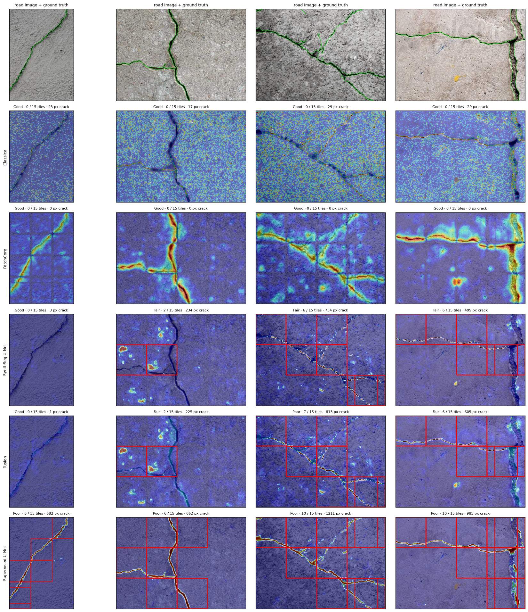
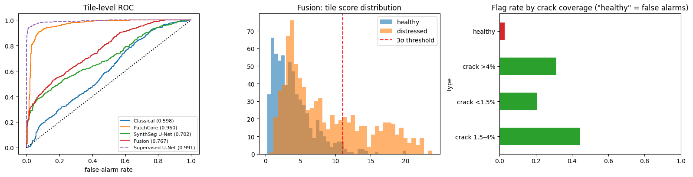

# 🛣️ RoadScan AI — Label-Free Road Surface Distress Detection

Detect and map **cracks, potholes, patches and stains** on road surfaces with models trained **only on healthy road**. The outputs are a road-condition report and a check of whether the model is fast enough to run on a survey vehicle.

## Why this matters for smart mobility

Road condition affects safety, vehicle wear, fuel use and ride comfort, and small cracks become potholes if they aren't caught early. Agencies and municipalities increasingly monitor roads with **survey vehicles, buses and dashcam fleets as moving sensors**. Two problems block scaling:

1. **Labels are expensive.** Pixel-annotating cracks takes hours per image.
2. **Every city looks different.** Asphalt, concrete, lighting and cameras all change, so a supervised model trained on one city degrades in the next.

RoadScan learns what *healthy road* looks like and flags everything else. Adapting to a new city only needs footage of normal road, which a vehicle collects just by driving.

## What's inside

| Component | What it shows |
|---|---|
| **Survey-grid tiling** of road images (128 px cells), with ambiguous border tiles excluded | Data engineering and careful evaluation protocol |
| **Classical crack detector**: CLAHE, morphological black-hat, multi-scale Frangi ridge filter | Image-processing fundamentals and an honest baseline |
| **PatchCore from scratch**: WideResNet-50 features, greedy k-center coreset with random projection, kNN scoring | Representation learning and implementing a CVPR paper |
| **SynthSeg U-Net** trained on procedurally generated distress: branching random-walk cracks plus Perlin potholes, patches and stains | Self-supervision through domain-aware synthetic data, a full training pipeline (focal + Dice, AMP, OneCycle) |
| **Fusion** of the two deep models, z-normalized on healthy road | Combining models with complementary strengths |
| **Supervised upper bound**: the same U-Net trained on the *real* labels | Measuring how much of supervised performance label-free methods recover |
| **3σ calibration** from healthy road only, reported as miss rate and false-alarm rate | Production-style thresholding without test leakage |
| **Road-condition report**: stitched full-image distress map, flagged tiles, crack length via skeletonization, illustrative severity grade | Turning model output into something a road agency can act on |
| **Cross-city test** (DeepCrack ↔ CrackForest): zero-shot, then PatchCore re-fit on healthy target road | Domain shift, and the practical payoff of label-free learning |
| **Edge deployment**: ONNX, static INT8 quantization, CPU latency converted to **max survey speed (km/h)** | In-vehicle deployment thinking |
| **Gradio demo** with a shareable link | Communicating results |

## Results

DeepCrack · 300 training images → 1,500 healthy training tiles · 100 test images → 1,477 test tiles (844 with cracks) · Kaggle T4 GPU

| Method | Labels used | tile AUROC | pixel AUROC | AUPRO@30% | ms/tile |
|---|---|---|---|---|---|
| Classical (black-hat + Frangi) | none | 0.598 | 0.491 | 0.404 | 161.6 |
| **PatchCore** | **none** | **0.960** | **0.952** | 0.689 | 29.0 |
| SynthSeg U-Net | none | 0.702 | 0.709 | 0.467 | 4.5 |
| Fusion (PatchCore + SynthSeg) | none | 0.767 | 0.920 | **0.701** | 35.2 |
| Supervised U-Net (reference) | real pixel labels | 0.991 | 0.981 | 0.935 | 4.4 |

**Key finding:** PatchCore reaches **97% of the supervised model's tile and pixel AUROC with zero defect labels**, and beats the classical crack filter by 36 AUROC points.

### Edge deployment (SynthSeg U-Net)

| Runtime | ms/tile | size MB | tile AUROC | pixel AUROC | max survey speed* |
|---|---|---|---|---|---|
| PyTorch fp16 (T4 GPU) | 7.0 | 57.3 | 0.702 | 0.709 | 104 km/h |
| ONNX fp32 (4-core CPU) | 65.6 | 57.3 | 0.702 | 0.709 | 11 km/h |
| ONNX INT8 (4-core CPU) | 48.6 | 14.5 | 0.753 | 0.682 | 15 km/h |

\*Assumes 15 tiles per camera frame and 3 m of road covered per frame.

INT8 quantization gives a **4× smaller model** and **26% faster CPU inference** for under 3 points of pixel-AUROC loss.

### Honest notes and next steps

- **Threshold calibration is too conservative.** The mean + 3σ rule on healthy tiles sits above most crack scores, because healthy-road scores have a long tail. Miss rates at that threshold are therefore high (PatchCore 98%, fusion 68%) even though ranking quality is strong. Next step: a label-free quantile threshold at a target false-alarm rate.
- **Synthetic-crack domain gap.** The U-Net trained on synthetic distress reaches only 0.70 AUROC, while the same architecture with real labels reaches 0.99. Fusion therefore helps region-level localization slightly (AUPRO 0.70 vs 0.69) but lowers tile AUROC. Next steps: more realistic crack rendering, and choosing fusion weights on synthetic validation data.
- The cross-city test (DeepCrack → CrackForest) is implemented but not yet run.

## Datasets

- **[DeepCrack](https://github.com/yhlleo/DeepCrack)** (main): 537 pavement and concrete images (544 × 384) with pixel-level crack masks.
- **[CrackForest (CFD)](https://github.com/cuilimeng/CrackForest-dataset)** (optional cross-city test): 118 urban-road images from Beijing (480 × 320) with pixel masks.

Both are restricted to non-commercial research and educational use, which covers a portfolio project. The notebook clones them inside Colab.

## Run it (free)

1. Click **Open in Colab** above.
2. `Runtime → Change runtime type → T4 GPU`.
3. `Runtime → Run all`. A full run takes ~25–30 min, and nothing is stored on your computer.
   On Kaggle, use **GPU T4 x2**, turn **Internet on**, and set `data_dir`/`out_dir` to `/kaggle/working/...` (the committed notebook already uses these).
4. Options in `CFG`: switch `dataset` to `cfd`, set `RUN_CROSS = True` for the cross-city test, change `frame_coverage_m` for the survey-speed estimate.

## Talking points for interviews

- **Why anomaly detection for roads?** Labels are costly and road appearance shifts between cities and cameras. Healthy-road footage is free to collect, and re-fitting to a new city needs no annotation.
- **Why tile the images?** It matches how pavement surveys grid the road, keeps the thin cracks at a resolution the CNN can see (tiles are upsampled 2×), and makes tile-level decisions easy to act on.
- **Why random-walk cracks instead of only Perlin blobs?** Generic blob anomalies don't look like cracks, which are thin, elongated and branching. Matching the synthetic data to the domain is what makes the label-free U-Net competitive.
- **How close is label-free to supervised?** PatchCore reaches 97% of supervised AUROC with no labels; the synthetic-data U-Net shows where the domain gap still hurts.
- **Is it fast enough for a vehicle?** Section 10 turns CPU latency into a maximum survey speed under a stated assumption about road coverage per frame.
- **Limitations and next steps:** the models are calibrated on top-down close-up pavement images, so a forward-facing dashcam needs a perspective (bird's-eye) warp first. Severity is illustrative rather than a calibrated Pavement Condition Index. Natural extensions are GPS-tagging tiles to build a city-scale road-health map, testing on Indian roads (e.g. the India subset of the RDD2022 road-damage dataset, which has bounding boxes rather than masks), and temporal tracking of crack growth.

## References

- Liu et al., *DeepCrack: A Deep Hierarchical Feature Learning Architecture for Crack Segmentation*, Neurocomputing 2019
- Shi et al., *Automatic Road Crack Detection Using Random Structured Forests* (CrackForest), IEEE T-ITS 2016
- Roth et al., *Towards Total Recall in Industrial Anomaly Detection* (PatchCore), CVPR 2022
- Zavrtanik et al., *DRAEM: A Discriminatively Trained Reconstruction Embedding for Surface Anomaly Detection*, ICCV 2021
- Frangi et al., *Multiscale Vessel Enhancement Filtering*, MICCAI 1998

## License

Code: MIT (see LICENSE). Datasets: non-commercial research and education only, per their authors.
